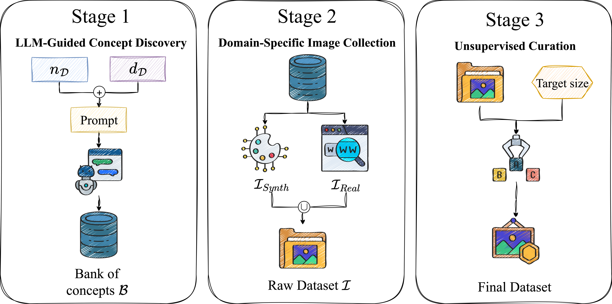

# Precision at Scale

[](https://doi.org/10.1016/j.patcog.2025.112236)
[](https://arxiv.org/abs/2407.03463)
[](LICENSE)
[](https://huggingface.co/collections/jesusmolrdv/precision-at-scale-datasets)
[](https://huggingface.co/collections/jesusmolrdv/precision-at-scale-ssl-backbones)

This repository contains the code and environment for the paper **["Precision at Scale: Domain-Specific Datasets On-Demand"](https://doi.org/10.1016/j.patcog.2025.112236)**, published in Pattern Recognition, 2026.

**Precision at Scale (PaS)** is a modular pipeline for automatically creating domain-specific image datasets on demand, without human curation or labeling. Given only a domain name and a short description, PaS uses Large Language Models to discover relevant domain concepts, Vision-Language and generative models to collect matching web and synthetic images, and automatic curation to remove out-of-domain and redundant content. Across the food, bird, and insect domains, models pretrained on PaS-generated datasets outperform both existing domain-specific datasets and much larger general-domain datasets such as ImageNet.



**To reproduce the Hugging Face datasets**, see [`REPRODUCING_HF_DATASETS.md`](REPRODUCING_HF_DATASETS.md) for the settings they were generated with. The examples in each Stage's README below are illustrative, not those settings.

## Datasets & Checkpoints

The PaS datasets and pretrained SSL backbones (MoCo v3, ViT-B/16) from the paper are released on Hugging Face:

| Domain | Dataset | Checkpoint |
|---|---|---|
| 🍔 Food | [`pas-f`](https://huggingface.co/datasets/jesusmolrdv/pas-f) ([`pas-fmini`](https://huggingface.co/datasets/jesusmolrdv/pas-fmini)) | [`mocov3-vitb16-pas-food`](https://huggingface.co/jesusmolrdv/mocov3-vitb16-pas-food) ([`-mini`](https://huggingface.co/jesusmolrdv/mocov3-vitb16-pas-food-mini)) |
| 🐦 Birds | [`pas-b`](https://huggingface.co/datasets/jesusmolrdv/pas-b) ([`pas-bmini`](https://huggingface.co/datasets/jesusmolrdv/pas-bmini)) | [`mocov3-vitb16-pas-birds`](https://huggingface.co/jesusmolrdv/mocov3-vitb16-pas-birds) ([`-mini`](https://huggingface.co/jesusmolrdv/mocov3-vitb16-pas-birds-mini)) |
| 🐞 Insects | [`pas-i`](https://huggingface.co/datasets/jesusmolrdv/pas-i) | [`mocov3-vitb16-pas-insects`](https://huggingface.co/jesusmolrdv/mocov3-vitb16-pas-insects) |

All five datasets are also collected in [Precision at Scale: Datasets](https://huggingface.co/collections/jesusmolrdv/precision-at-scale-datasets), and all five checkpoints in [Precision at Scale: SSL backbones](https://huggingface.co/collections/jesusmolrdv/precision-at-scale-ssl-backbones).

## What this repository contains

This release covers the paper's Section 3 dataset-generation pipeline: Stages 1–3, from a domain name and description to a curated image dataset. Section 4's diversity-analysis framework is not included. Neither is Section 5's evaluation: the SSL pretraining, fine-tuning, and VLM LoRA protocols there follow standard third-party recipes with the hyperparameters tabulated in the paper's appendix. The resulting datasets and SSL checkpoints are released on Hugging Face (see the table above).

## Environment

Every step of the pipeline runs inside a container (Singularity for SLURM/HPC use, or Docker for local/other use), never directly on the host. There are four images, shared across stages where their dependencies overlap:

| Image | Base | Used by |
|---|---|---|
| `singularity/llama_cpp_python/` | `nvidia/cuda:12.1.1-devel-ubuntu22.04` | Stage 1: Concept Generation; Stage 2 prompt generation (mixtral/mistral/llama2-13b via `llama-cpp-python`, GPU-offloaded) |
| `singularity/clip_retrieval/` | `condaforge/miniforge3` (`clipretrieval` conda env) | Stage 2 web retrieval; Stage 3 SSCD embeddings, CLIPN OOD scoring, and pareto filtering |
| `singularity/torch_tensorrt/` | `nvcr.io/nvidia/pytorch:23.07-py3` | Stage 2 synthetic image generation (TensorRT diffusion); Stage 3 deduplication |
| `singularity/tmars/` | `condaforge/miniforge3` (`tmars` conda env) | Stage 3 OOD text detection ([T-MARS](https://github.com/locuslab/T-MARS)) |

Each image directory has both a `singularity.def` and a `Dockerfile` describing the same environment. Build either directly from the repo root (`singularity build singularity/<name>/<name>.sif singularity/<name>/singularity.def` / `docker build -t pas-<name> singularity/<name>`); the `torch_tensorrt` recipe copies a file by its repo-root-relative path, so its Singularity build fails from any other directory. On a SLURM cluster, prefer `singularity/build_image.sh <image_name>` over running `singularity build` directly: it submits the build as a SLURM job with `--fakeroot` and a configurable `SINGULARITY_TMPDIR`, so a large build doesn't fill up a small `/tmp`.
**Note**: the `llama_cpp_python` image builds `llama-cpp-python` from source against CUDA; build times and CUDA-flag compatibility vary by driver version.

**Export `PROJECT_ROOT` to the repo root before running any step.** Commands are run from inside a Stage directory (see Quickstart below), but Stage 2/3 scripts reference sibling stages via relative `../Stage_X/...` paths. `run.sh` binds `$PROJECT_ROOT` (falling back to your current directory if unset) into the container, for both Singularity and Docker, so leaving it unset means those cross-stage paths don't resolve inside the container even though they exist on the host, failing with `FileNotFoundError`.

Everything machine-specific is set through environment variables; nothing in the repo names a host or path of its own:

| Variable | Read by | Default | Purpose |
|---|---|---|---|
| `PROJECT_ROOT` | `run.sh` | current directory | Repo root, bound into the container |
| `IMAGE_DIR` | `run.sh` (or `--image-dir`) | `singularity/` | Where the `<image>/<image>.sif` files live |
| `SD21_BASE_LOCAL_PATH` | `run.sh` → Stage 2 | unset (Hugging Face repo id) | Local Stable Diffusion 2.1-base copy, see `Stage_2/README.md` |
| `SBATCH_ACCOUNT`, `SBATCH_PARTITION`, `SBATCH_QOS` | `singularity/build_image.sh` | `your-account`, `your-partition`, `your-qos` | SLURM settings for image builds |
| `SINGULARITY_BUILD_TMPDIR_ROOT` | `singularity/build_image.sh` | `$HOME/singularity_build_tmp` | Scratch space for image builds |

## Quickstart

Use `run.sh` instead of invoking `singularity`/`docker` directly: it picks the right image for you. Each command below runs from inside its own Stage directory (paths like `config/birds.yaml` and `scripts/main_prompts.py` are relative to that Stage, not the repo root), invoking `run.sh` from there via a relative `../run.sh`. It resolves images relative to its own location, not your current directory. A minimal, single-domain, end-to-end run looks like this (see each Stage's README, linked below, for every argument):

```bash
export PROJECT_ROOT="$(pwd)"

# Stage 1: LLM-guided concept discovery
cd Stage_1
../run.sh stage1 -- python3 main.py --config config/birds.yaml --output_dir output/birds --num_seeds 50

# Stage 2: image collection. Web retrieval only needs Stage 1's concepts; synthetic
# generation needs prompt generation first. Prompts, web retrieval, and (once
# prompts are ready) synthetic generation can all run in parallel.
cd ../Stage_2
../run.sh stage2-prompts -- python3 scripts/main_prompts.py --concepts ../Stage_1/output/birds/valid_concepts.json --domain birds --category-desc "bird species" --output output/birds/prompts.json --num-prompts 5
../run.sh stage2-web -- python scripts/main_web.py --query_files ../Stage_1/output/birds/valid_concepts.json --output_file output/birds/web_retrieval.parquet --prefix "a photo of a " --suffix "" --indices_json_path laion5b/indices.json --num_images 500 --num_result_ids 500
../run.sh stage2-synth -- python3 scripts/main_synth.py --prompts output/birds/prompts.json --output-dir output/birds/images/synth --img-per-prompt 35

../run.sh stage2-download -- img2dataset --url_list output/birds/web_retrieval.parquet --input_format parquet --url_col url --output_folder output/birds/images/web --processes_count 6 --thread_count 256 --image_size 384 --resize_mode keep_ratio_largest --resize_only_if_bigger True --output_format files --encode_format jpg --retries 10 --incremental_mode extend --disallowed_header_directives '["noai","noimageai","noindex","noimageindex"]'
mkdir -p output/birds/images/web_wds
../run.sh stage2-web-wds -- python scripts/generate_wds_from_web.py --input output/birds/images/web --queries output/birds/web_retrieval.parquet --output output/birds/images/web_wds
../run.sh stage2-synth-wds -- python scripts/generate_wds_from_synth.py --prompts output/birds/prompts.json --output-dir output/birds/images/synth_wds --input-dir output/birds/images/synth --img-per-prompt 35 --overwrite

../run.sh stage2-combine -- python scripts/combine_wds_sources.py --sources web=output/birds/images/web_wds,synthetic=output/birds/images/synth_wds --output_dir output/birds/images/combined_wds

# Stage 3: dedup, OOD scoring (CLIPN + text detection), Pareto filtering to the target size, then export
cd ../Stage_3
../run.sh stage3-embeddings -- python scripts/generate_sscd_embeddings.py --dataset ... --embedding_dir ...
../run.sh stage3-dedup -- python3 scripts/deduplication.py --df_paths ... --tar_dir ...
../run.sh stage3-textdetect -- python scripts/generate_blurred_images.py --bbox_info_dir ... --webdataset_dir ...
../run.sh stage3-clipn -- python scripts/ood_clipn.py --pre_trained_model_path ... --classes ...
../run.sh stage3-merge-stats -- python scripts/merge_statistics.py --input_df_paths ... --dedup_df_path ... --output_df_path ...
../run.sh stage3-pareto -- python scripts/pareto_filtering.py --df_path ... --output_df_path ...
../run.sh stage3-export -- python scripts/export_dataset.py --pareto_df_path ... --tar_dir ... --output_dir ...
```

The last step writes the finished dataset: a webdataset of the selected images (`<key>.jpg` + `<key>.json` per image, with `concept`, `source` and the `prompt` or `url`), plus a parquet index per shard.

By default `run.sh` uses Singularity and expects `.sif`s at `singularity/<image>/<image>.sif`; pass `--runtime docker` to use Docker instead (build once per image with `docker build -t pas-<image> singularity/<image>`). With Docker the container runs as root, so files it writes under the project tree (outputs, model caches) are owned by root on the host; `chown -R` them afterwards if that matters on your machine. Run `./run.sh` with no arguments for the full list of steps.

## Code

### Stage 1: Concept generation

The code for Stage 1 and detailed instructions can be found in the [Stage 1 README](Stage_1/README.md).

### Stage 2: Image collection

The code for Stage 2 and detailed instructions can be found in the [Stage 2 README](Stage_2/README.md).

### Stage 3: Automatic curation

The code for Stage 3 and detailed instructions can be found in the [Stage 3 README](Stage_3/README.md).

### Swapping models

The pipeline makes no assumptions about which models it runs; the released code just ships the three used for the released datasets. To add another GGUF LLM for concept discovery (L1/L2/L3), add an entry to `LLM_DEFAULT_CONFIGS` in `Stage_1/main.py`'s `build_configs()`, pointing at the new `.gguf` under `Stage_1/models/`, and add its name to the `choices` of `--model_seeds`/`--model_expand`/`--model_check`. For prompt generation (L4), the same entry goes in the dict returned by `build_configs()` in `Stage_2/scripts/main_prompts.py`, plus its `--model` `choices`. For another Stable Diffusion version, pass `--version` to `Stage_2/scripts/main_synth.py` (default `2.1-base`); the TensorRT engines are rebuilt from that version on the first run.

## License

The code in this repository is released under the [MIT License](LICENSE). Note this covers the *code* only; the datasets and checkpoints on Hugging Face are released under CC BY-NC 4.0 (see each card), as is the paper itself (see the publisher page linked above).

## Acknowledgements

This pipeline builds on several open-source projects:

- [T-MARS](https://github.com/locuslab/T-MARS) for OOD text detection
- [CLIPN](https://github.com/xmed-lab/CLIPN) for OOD scoring
- [SSCD](https://github.com/facebookresearch/sscd-copy-detection) for copy-detection embeddings used in deduplication
- [`clip-retrieval`](https://github.com/rom1504/clip-retrieval) and [Re-LAION-5B](https://laion.ai/blog/relaion-5b/) for web image retrieval
- [`llama-cpp-python`](https://github.com/abetlen/llama-cpp-python) for GPU-offloaded LLM inference

We thank their authors for making this work possible.

## Citation

```bibtex
@article{rodriguezdevera2026precision,
  title   = {Precision at scale: Domain-specific datasets on-demand},
  author  = {Rodr{\'i}guez-de-Vera, Jes{\'u}s M. and Estepa, Imanol G. and Saras{\'u}a, Ignacio and Nagarajan, Bhalaji and Radeva, Petia},
  journal = {Pattern Recognition},
  volume  = {171},
  pages   = {112236},
  year    = {2026},
  publisher = {Elsevier},
  doi     = {10.1016/j.patcog.2025.112236}
}
```

