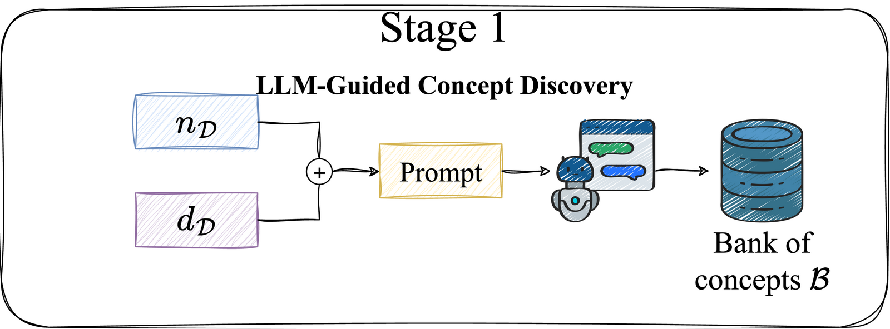

# Stage 1



Stage 1 turns a domain name and description into a curated bank of concepts (`valid_concepts.json`) via LLM-guided discovery, expansion, and filtering. Using the Singularity image defined in `singularity/llama_cpp_python/singularity.def`.

Example usage:

```bash
mkdir -p output/birds
../run.sh stage1 -- python3 main.py --config config/birds.yaml --output_dir output/birds --num_seeds 50
```

This will generate the file `output/birds/valid_concepts.json` with the list of concepts.

## Arguments

`--num_seeds` is **required**, with no default: it's the number of concepts
requested per Step-1 (`generate_seeds`) LLM call, baked into the prompt
(`templates/generate_seeds.txt`'s `{num_seeds}` placeholder).

**Inspect `valid_concepts.json` before moving on.** With a small `--num_seeds`, few iterations, or a smaller model than the defaults, the generator sometimes echoes the format example from the prompt (`"concept 1"`, `"concept 2"`, ...) back as if those were real concepts, and the L_3 check does not always reject them. If you see such entries in the output, raise `--num_seeds` and the iteration counts (`num_iters_seeds`, `seed_expansion.num_iters`), or use the default models.

## Config file

Everything else comes from the YAML passed to `--config` (see
`config/{food,birds,insects}.yaml`):

| Key | Meaning |
|---|---|
| `domain`, `category_desc` | The domain name and short description, the pipeline's only two inputs |
| `num_iters_seeds` | Max Step-1 sampling rounds |
| `relative_threshold_seeds` | Stop Step 1 once the relative growth in new concepts falls below this |
| `seed_expansion.num_iters` | Max Step-2 expansion rounds |
| `seed_expansion.relative_threshold` | Same stopping rule for Step 2 |
| `seed_expansion.target_num_concepts`, `seed_expansion.force_stop` | Concept-count budget, and whether to stop as soon as it's reached |
| `validate_seeds`, `seed_expansion.validate_concepts` | Optional early concept filter inside Step 1 / Step 2 (default off) |

`validate_seeds` and `seed_expansion.validate_concepts` are an optimisation,
not the paper's validation step: they run the check prompt with the model that
just *generated* the concepts (L_1 in Step 1, L_2 in Step 2), so obviously
implausible concepts don't consume expansion compute. The released Birds and
Insects datasets enabled them for that reason. The validation the paper describes
is the final pass with a separate model L_3 (`--model_check`, distinct from
`--model_seeds`/`--model_expand`), which always runs and is what produces
`valid_concepts.json`.

## Models

`main.py` looks for GGUF model files in a `models/` directory relative to
wherever it's run from (so `models/` here, next to `main.py`, matching the
example above).

| `--model_seeds`/`--model_expand`/`--model_check` value | Expected file | Download |
|---|---|---|
| `mixtral` (default for seeds/expansion) | `models/mixtral-8x7b-instruct-v0.1.Q4_K_M.gguf` (~26.4GB) | `huggingface-cli download mradermacher/Mixtral-8x7B-Instruct-v0.1-GGUF Mixtral-8x7B-Instruct-v0.1.Q4_K_M.gguf --local-dir models` then rename the downloaded file to `mixtral-8x7b-instruct-v0.1.Q4_K_M.gguf`. **Not** `TheBloke/Mixtral-8x7B-Instruct-v0.1-GGUF`: that repo's file predates llama.cpp's merged-expert-tensor GGUF layout and fails to load ("missing tensor 'blk.0.ffn_down_exps.weight'") against any current `llama-cpp-python` |
| `mistral` | `models/mistral-7b-instruct-v0.1.Q5_K_M.gguf` (~5.1GB) | `huggingface-cli download TheBloke/Mistral-7B-Instruct-v0.1-GGUF mistral-7b-instruct-v0.1.Q5_K_M.gguf --local-dir models` |
| `llama2-13b` (default for the check step) | `models/llama-2-13b-chat.Q5_K_M.gguf` (~9.2GB) | `huggingface-cli download TheBloke/Llama-2-13B-chat-GGUF llama-2-13b-chat.Q5_K_M.gguf --local-dir models` |

`--model_seeds`/`--model_expand`/`--model_check` each default independently
(see `main.py --help`), so a default run of the example above needs at least
`mixtral` and `llama2-13b`; `mistral` is only needed if you pass
`--model_seeds mistral` / `--model_expand mistral` / `--model_check mistral`
explicitly.

No `huggingface-cli`? A plain `wget`/`curl` against the same repo's
`resolve/main/<filename>` URL works too, e.g.:
```bash
mkdir -p models
wget -O models/llama-2-13b-chat.Q5_K_M.gguf \
    https://huggingface.co/TheBloke/Llama-2-13B-chat-GGUF/resolve/main/llama-2-13b-chat.Q5_K_M.gguf
```
