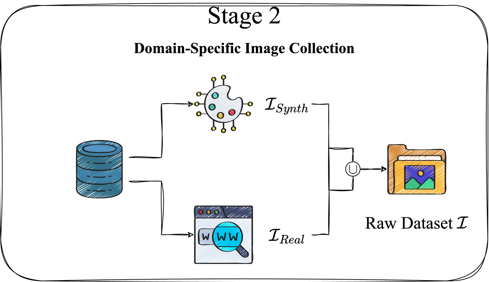

# Stage 2



Stage 2 collects real (web-retrieved) and synthetic images per concept and combines both sources into a single raw dataset for Stage 3.

## Web image retrieval

Using the Singularity image defined in `singularity/clip_retrieval/singularity.def`

### Querying the LAION-5B index

Following the instructions from the [`clip-retrieval`](https://github.com/rom1504/clip-retrieval/blob/main/docs/laion5B_back.md) repository, a file `indices.json` is provided in the `laion5b` folder.

**Use Re-LAION-5B, not the original LAION-5B.** The original LAION-5B dataset and its precomputed retrieval index were taken offline in December 2023 after Stanford Internet Observatory found suspected CSAM links in it; LAION's safety-reviewed replacement, [Re-LAION-5B](https://laion.ai/blog/relaion-5b/), is the current, legitimate source.

A precomputed, clip-retrieval-ready FAISS index for it is published at [`laion/relaion2B-en-research-safe-index`](https://huggingface.co/datasets/laion/relaion2B-en-research-safe-index) on Hugging Face. Download it into `laion5b/relaion5B-index/` (matching `indices.json`'s `indice_folder`) before running the command below.

**The Hugging Face download arrives split into `image.index.part_NNN`/`text.index.part_NNN`/`metadata.hdf5.part_NNN` files.** `clip-retrieval` only looks for the unsplit `image.index`/`text.index`/`metadata.hdf5` filenames, so these parts must be concatenated in numeric order before the index is usable. They are a plain byte split, not separate index shards:
```bash
cat image.index.part_* > image.index
cat text.index.part_* > text.index
cat metadata.hdf5.part_* > metadata.hdf5
```
This roughly doubles the disk used until the `.part_*` files are deleted (the combined files total a bit over 400GB).

Queries by concept name, not by a generated prompt/caption: `--query_files` should point at Stage 1's `valid_concepts.json` (a plain JSON list of concept strings), not at this stage's own `prompts.json` (which is for synthetic generation only, see below). Only needs Stage 1's output, so it can run independently of prompt generation.

Example usage:
```bash
python scripts/main_web.py --query_files ../Stage_1/output/birds/valid_concepts.json --output_file output/birds/web_retrieval.parquet --prefix "a photo of a " --suffix "" --indices_json_path laion5b/indices.json --num_images 500 --num_result_ids 500
```

`--last` defaults to `1000000` and silently skips any query beyond that index; raise it if `--query_files` has more concepts than that. `--first`/`--last` also let you split a run across jobs or resume one; `--save_every` (default `20`) controls how often the output parquet gets written during the run.

Each retrieved row carries the cosine similarity between its image embedding and the query embedding, written to the output parquet as a `similarity` column. `--min_similarity` is the paper's retrieval threshold λWeb: only results above it are kept. It is off by default, so every one of the `--num_images` nearest results is kept. Each row also records `query` (the text sent, prefix + concept + suffix) and `concept` (the bare concept), which is carried through to every web image's metadata in the final dataset.

### Download the images from the retrieved URLs

We use the tool `img2dataset` to download the images from the retrieved URLs. `--num_images`/`--num_result_ids` above, `--image_size` and `--retries` below are domain-specific. See [`REPRODUCING_HF_DATASETS.md`](../REPRODUCING_HF_DATASETS.md) for the full per-domain command used for the released datasets. No `--save_additional_columns` is passed: a current `img2dataset` reserves `caption` for its own internal use and errors if it's listed there, and nothing downstream needs the per-image caption sidecar it would produce anyway, since `web_retrieval.parquet` (used directly by `generate_wds_from_web.py`) already has it.

`--disallowed_header_directives` is passed explicitly so the download honours the paper's commitment to respect `X-Robots-Tag` HTTP headers: any image served with `noai`, `noimageai`, `noindex` or `noimageindex` is skipped. These four are `img2dataset`'s own default, but naming them keeps the behaviour verifiable and independent of the installed version.
```bash
img2dataset --url_list output/birds/web_retrieval.parquet --input_format parquet --url_col url --output_folder output/birds/images/web --processes_count 6 --thread_count 256 --image_size 384 --resize_mode keep_ratio_largest --resize_only_if_bigger True --output_format files --encode_format jpg --retries 10 --incremental_mode extend --disallowed_header_directives '["noai","noimageai","noindex","noimageindex"]'
```

**Under `--runtime docker`, run the `mkdir -p` inside the container too.** This applies to every `mkdir -p` in this README: the Docker container runs as root, so an `output/...` tree created by a containerised step (here, `img2dataset`'s `--output_folder`) is root-owned on the host, and a plain host-side `mkdir -p` underneath it fails with "Permission denied". Either fold the `mkdir` into the containerised command (`../run.sh stage2-web-wds --runtime docker -- bash -c "mkdir -p output/birds/images/web_wds && python scripts/generate_wds_from_web.py ..."`) or `chown -R` the tree back to your user first.

Convert the downloaded images to a webdataset format:
```bash
mkdir -p output/birds/images/web_wds
python scripts/generate_wds_from_web.py --input output/birds/images/web --queries output/birds/web_retrieval.parquet --output output/birds/images/web_wds
```


## Synthetic image generation

### Prompt generation

Example usage:
```bash
mkdir -p output/birds/
python3 scripts/main_prompts.py --concepts ../Stage_1/output/birds/valid_concepts.json --domain birds --category-desc "bird species" --output output/birds/prompts.json --num-prompts 5
```

### Image generation

Using the Singularity image defined in `singularity/torch_tensorrt/singularity.def`

The code in the folder `src/tensorrt` is based on the [TensorRT Diffusion demo](https://github.com/NVIDIA/TensorRT/tree/release/8.6/demo/Diffusion).

`main_synth.py` imports from the sibling `src/tensorrt` package, which needs `PYTHONPATH=.` to resolve (`run.sh` sets this automatically).

Example usage:
```bash
mkdir -p output/birds/images/synth
PYTHONPATH=. python3 scripts/main_synth.py --prompts output/birds/prompts.json --output-dir output/birds/images/synth --img-per-prompt 35
```

**If this fails pulling `stabilityai/stable-diffusion-2-1-base` (`401`/`RepositoryNotFoundError`):** that repo has been down/inaccessible on Hugging Face to anonymous requests since ~Nov 2025. This is a known upstream outage, not a bug here. Setting `HF_HUB_OFFLINE=1`/`TRANSFORMERS_OFFLINE=1` alone isn't reliable: `transformers`'s own file-existence check still hits the network regardless of those flags. Instead, set `SD21_BASE_LOCAL_PATH` (read by `Stage_2/src/tensorrt/models.py::get_path()`) to a local directory with `tokenizer/`, `text_encoder/`, `vae/`, `unet/` subfolders; `from_pretrained` resolves a real local path with zero network calls.

This step is needed even if the model is already in your host's Hugging Face cache: `run.sh` points `HF_HOME` at `$PROJECT_ROOT/.cache/huggingface` inside the container, so the host cache under `~/.cache/huggingface/hub` is never consulted and the load still tries (and fails) to reach the Hub. That host cache is, however, the easiest place to get the files from: assemble the directory somewhere **under `$PROJECT_ROOT`** and **copy** (`cp -rL`) or hard-link the components into it. `run.sh` binds only `$PROJECT_ROOT` into the container, so a symlink whose target is the host cache outside that tree is dangling inside the container and the load fails with a generic file-not-found. The cache stores each revision under a snapshot hash, and `refs/` says which hash is which revision. `unet` comes from the `fp16` snapshot, `tokenizer`/`text_encoder`/`vae` from `main`:
```bash
HUB=~/.cache/huggingface/hub/models--stabilityai--stable-diffusion-2-1-base
MAIN=$(cat "$HUB/refs/main")
FP16=$(cat "$HUB/refs/fp16")
mkdir -p "$PROJECT_ROOT/Stage_2/models/sd21_base"
cp -rL "$HUB/snapshots/$MAIN"/{tokenizer,text_encoder,vae} "$PROJECT_ROOT/Stage_2/models/sd21_base/"
cp -rL "$HUB/snapshots/$FP16/unet" "$PROJECT_ROOT/Stage_2/models/sd21_base/"
export SD21_BASE_LOCAL_PATH="$PROJECT_ROOT/Stage_2/models/sd21_base"
```

Both `.safetensors` and the older `.bin` checkpoint files load; without a cached copy you'll need one from before the outage or another source. `SD21_BASE_LOCAL_PATH` falls back to the repo id when unset, so this has no effect once/if the upstream repo comes back.

We then convert the generated images to a webdataset format. Despite living in this section, `generate_wds_from_synth.py` only needs `polars`/`webdataset`, so it runs under `singularity/clip_retrieval/singularity.def` (the same image as web retrieval above), not `torch_tensorrt` (which lacks `polars`). Like `main_synth.py` it imports from the sibling `src/` package, so it needs `PYTHONPATH=.` too:
```bash
mkdir -p output/birds/images/synth_wds
PYTHONPATH=. python scripts/generate_wds_from_synth.py --prompts output/birds/prompts.json --output-dir output/birds/images/synth_wds --input-dir output/birds/images/synth --img-per-prompt 35 --overwrite
```

## Combining sources for Stage 3

Stage 3 (Deduplication, CLIPN OOD scoring, Text Detection) always runs **once** on a single unified, `source`-tagged input rather than once per source: combine the web and synthetic webdatasets first.
```bash
mkdir -p output/birds/images/combined_wds
python scripts/combine_wds_sources.py --sources web=output/birds/images/web_wds,synthetic=output/birds/images/synth_wds --output_dir output/birds/images/combined_wds
```
This writes source-prefixed parquet files directly into `--output_dir`
(`web__000000.parquet`, `synthetic__000000.parquet`, ...) and symlinks
(not copies) the matching tar files directly into `--output_dir` too, under the
same source-prefixed names (the tar must sit next to its parquet, not in a
nested subdirectory), so no tar binaries are duplicated even though
each source's chunks may independently reuse basenames like `000000.tar`.
Point Stage 3 at `--tar_dir output/birds/images/combined_wds` and
`--df_paths` at a glob over `output/birds/images/combined_wds/*.parquet`.
`--sources` accepts any number of `name=dir` pairs, not just two.
