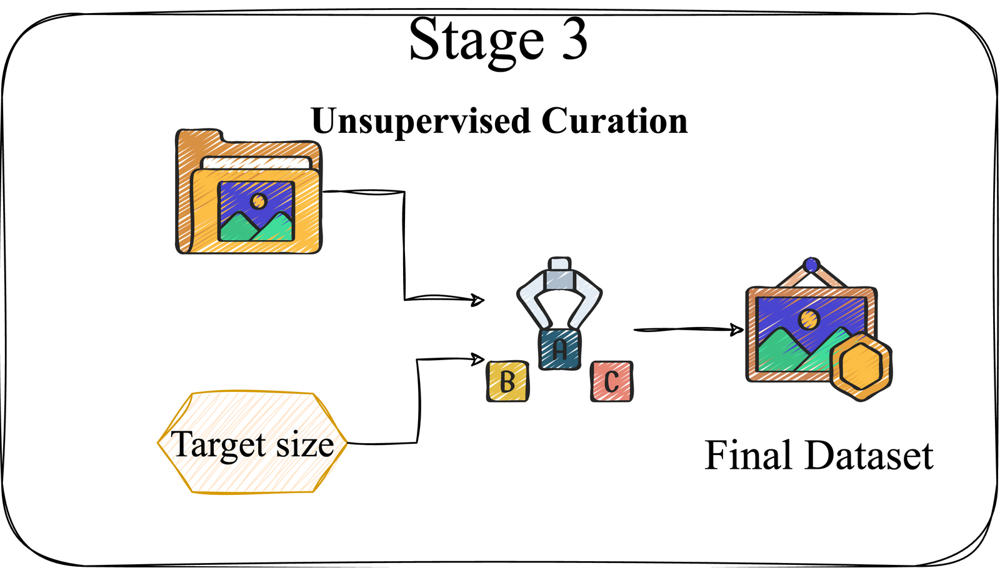

# Stage 3



Stage 3 deduplicates the raw dataset, scores images for domain relevance (CLIPN + text detection), and applies Pareto filtering down to the target dataset size.

**All `python scripts/...` commands below require `PYTHONPATH=.`** (e.g. `PYTHONPATH=. python scripts/deduplication.py ...`; `deduplication.py` specifically runs under `torch_tensorrt`, which only has `python3`, not `python`; see that section below). `run.sh` (see the top-level README) sets this automatically.

## Evaluation-set overlap removal

**This whole section is optional**, as is `merge_statistics.py`'s `--eval_overlap_df_path` flag below: leave both out and the merge runs on the deduplicated set only. If the dataset will be used to pretrain a model that is then benchmarked, images that are near-duplicates of the benchmark's test images have to be removed first. Embed the evaluation images with `generate_sscd_embeddings.py` exactly as the dataset itself is embedded (see "Compute SSCD embeddings" below, after packing the test images into a webdataset), then:
```bash
mkdir -p curation/all/
python3 scripts/remove_eval_overlap.py --embedding_dir embeddings/combined/sscd_large/ --reference_embedding_dir embeddings/evaluation/sscd_large/ --threshold 0.45 --output_df_path curation/all/remove_eval_overlap.parquet
```
An image is removed when its cosine similarity to the nearest evaluation image is greater than `--threshold` (0.45, on the same scale as deduplication's 0.6 but stricter). The output is a `key`/`Selected` parquet; pass it to `merge_statistics.py --eval_overlap_df_path` below and the unselected rows are dropped from the final dataset. This step needs the dataset's SSCD embeddings, so run it after "Compute SSCD embeddings".

## Deduplication

Deduplication (like CLIPN and Text Detection below) runs **once**, on a single unified input combining every source (web + synthetic), not once per source. First run [`Stage_2/scripts/combine_wds_sources.py`](../Stage_2/README.md#combining-sources-for-stage-3) (see `Stage_2/README.md`'s "Combining sources for Stage 3" section):
```bash
mkdir -p ../Stage_2/output/birds/images/combined_wds
python ../Stage_2/scripts/combine_wds_sources.py --sources web=../Stage_2/output/birds/images/web_wds,synthetic=../Stage_2/output/birds/images/synth_wds --output_dir ../Stage_2/output/birds/images/combined_wds
```

### Compute SSCD embeddings

We use the Singularity image defined by the `singularity/clip_retrieval/singularity.def` file.

Download the SSCD model from https://dl.fbaipublicfiles.com/sscd-copy-detection/sscd_disc_large.torchscript.pt and place it in the `models` folder.
```bash
mkdir -p models
wget https://dl.fbaipublicfiles.com/sscd-copy-detection/sscd_disc_large.torchscript.pt -O models/sscd_disc_large.torchscript.pt
```

Generate the embeddings, once, against the combined output (must run *after*
the combine step above, because embeddings are computed on `combined_wds/*.parquet`,
not per-source):
`--dataset` takes a glob, not a single file. Pass it once across every source, not once per file. Each invocation numbers its own output chunks from 0, so calling this per-file (looping over `combined_wds/*.parquet`) makes later sources silently overwrite earlier ones' embeddings under the same `chunk_000000` name:
```bash
mkdir -p embeddings/combined/sscd_large/
python scripts/generate_sscd_embeddings.py --dataset '../Stage_2/output/birds/images/combined_wds/*.parquet' --embedding_dir embeddings/combined/sscd_large/ --cuda
```

### Deduplicate the embeddings

We use the Singularity image defined by the `singularity/torch_tensorrt/singularity.def` file.

`--knn_algorithm` selects the k-NN index: `ivfpq` (the default) builds the approximate inverted-file/product-quantised graph, `brute` computes exact neighbours. The IVF-PQ build parameters are `--ivfpq_nlist`, `--ivfpq_nprobe` (32), `--ivfpq_m` (64, must divide the 1024-d embedding) and `--ivfpq_n_bits` (8). `--ivfpq_nlist` defaults to √N (the number of embeddings), capped at 1024, computed at fit time, so nothing needs changing for small datasets; pass it explicitly to override.

`--df_paths` is a single comma-separated string (`args.df_paths.split(",")` in `scripts/deduplication.py`), not a shell glob. Build the comma-joined list explicitly:
```bash
mkdir -p curation/all/
DF_PATHS=$(ls ../Stage_2/output/birds/images/combined_wds/*.parquet | paste -sd, -)
python3 scripts/deduplication.py --df_paths "$DF_PATHS" --tar_dir ../Stage_2/output/birds/images/combined_wds --embedding_dir embeddings/combined/sscd_large/ --output_df_path curation/all/remove_duplicates.parquet --output_adj_matrix_path curation/all/02_adj_matrix_dedup_64nn_0.6.npz --threshold 0.6 --k 64 --knn_algorithm ivfpq
```
`--k 64 --threshold 0.6` are the values used for all three domains. See [`REPRODUCING_HF_DATASETS.md`](../REPRODUCING_HF_DATASETS.md) for every other stage's per-domain values.

## OOD metrics

Like Deduplication above, Text Detection and CLIPN also run **once**, on the same `combined_wds/` unified input from `combine_wds_sources.py`.

### Text detection

We use the Singularity image defined by the `singularity/tmars/singularity.def` file. It builds [T-MARS](https://github.com/locuslab/T-MARS)'s own `dataset2metadata` CLI (an `mmocr`-based text-box detector) at image build time; nothing here reimplements it.

`dataset2metadata` takes a YAML config, not CLI flags, and two of its defaults don't fit this repo's data:
- `additional_fields` defaults to `[key, url, caption, original_width, original_height]`, assumed present in every tar's per-sample JSON sidecar. `combine_wds_sources.py`'s web and synthetic sources share no common field (synthetic has neither `key`, `url`, nor `caption`). A missing field raises an internal `KeyError` that `dataset2metadata` silently treats as "drop this sample" rather than failing the job, so every sample gets dropped and you get a 0-row output parquet with no error. `generate_blurred_images.py` below never reads these fields anyway (it matches bbox rows to images positionally), so set `additional_fields: []`.
- `input_tars` does not accept a shell glob: `combined_wds/*.tar` resolves to a literal, nonexistent shard named `*.tar` and is silently skipped. It only brace-expands an explicit `{file1.tar,file2.tar,...}` list, so build that list from the real tar basenames first.

T-MARS's own pinned `torch==1.13.0`/`torchvision==0.14.0` also predates Hopper (H100/`sm_90`) support: running this on an H100 GPU doesn't error, it silently corrupts the detection output. Request an older GPU generation.

```bash
mkdir -p statistics/text_detection/combined
TAR_BASENAMES=$(cd ../Stage_2/output/birds/images/combined_wds && ls -- *.tar | paste -sd, -)

cat > text_detection.yaml << YAMLEOF
models:
  - texts-mmocr-snake
postprocess_columns:
  - text-boxes
additional_fields: []
nworkers: 10
batch_size: 128
device: 0
input_tars: "$(pwd)/../Stage_2/output/birds/images/combined_wds/{${TAR_BASENAMES}}"
output_metadata_dir: "$(pwd)/statistics/text_detection/combined/"
custom_pypath: null
YAMLEOF

../run.sh stage3-textdetect -- bash -c \
    "cd /usr/T-MARS/dataset2metadata/text_detection && \
     PYTHONPATH=/usr/T-MARS/dataset2metadata/text_detection/mmocr dataset2metadata --yml $(pwd)/text_detection.yaml"
```

The `PYTHONPATH` override works around T-MARS's own editable `mmocr` install resolving one directory too shallow (Python treats it as an implicit namespace package with no `digit_version` attribute). Without it, `dataset2metadata` fails importing `mmocr.apis`.

This writes one or more parquet files under `output_metadata_dir` (here `statistics/text_detection/combined/`). `--bbox_info_dir` below takes that *directory*, not a single parquet file. The output directory must be a *sibling* of `combined_wds` named `combined_wds_blurred`, not a subdirectory of it. That's the exact path `scripts/ood_clipn.py --append_blurred` resolves (`--tar_dir` with `_blurred` appended).

Same `tmars` image as the `dataset2metadata` call above, so also wrapped in `run.sh stage3-textdetect`:
```bash
mkdir -p ../Stage_2/output/birds/images/combined_wds_blurred/
../run.sh stage3-textdetect -- python scripts/generate_blurred_images.py --bbox_info_dir statistics/text_detection/combined/ --webdataset_dir ../Stage_2/output/birds/images/combined_wds/ --output_dir ../Stage_2/output/birds/images/combined_wds_blurred/
```

The blurred images are stored in `../Stage_2/output/birds/images/combined_wds_blurred/`, one output tar per input tar (basenames preserved, e.g. `web__000000.tar` → `web__000000.tar`).

### CLIPN

Using the Singularity image defined by the `singularity/clip_retrieval/singularity.def` file.

We download the pre-trained CLIPN model from https://github.com/xmed-lab/CLIPN and place it in the `pretrained` folder.

We compute the OOD scores once, over the combined Web+Synthetic images.

`--classes` takes exactly one string (argparse `type=str`, no `nargs`): either a bare class name or a path to a JSON/text file with one class per line/entry, not multiple space-separated tokens. For any multi-class list, use the file-based convention below. `--df_paths` is a single comma-separated string (`args.df_paths.split(",")`), not a shell glob (same caveat as `--df_paths` above, Deduplication section). Output filenames matter: `merge_statistics.py` derives each file's CLIPN variant (`detect_ood_clipn`/`detect_ood_clipn_queries`/...) from the `combined_<statistic>.parquet` naming convention below (see "Merge the statistics").
```bash
mkdir -p statistics/
DF_PATHS=$(ls ../Stage_2/output/birds/images/combined_wds/*.parquet | paste -sd, -)
# `--classes` takes one class name or a JSON file, never a list on the CLI.
# The recommended way to express a multi-class list is a small JSON file
# containing a flat array, e.g. classes.json: ["food", "food dish"]
echo '["food", "food dish"]' > classes.json
python scripts/ood_clipn.py --pre_trained_model_path pretrained/clipn_ctw_vitb16.pt --classes classes.json --batch_size 4096 --df_paths "$DF_PATHS" --tar_dir ../Stage_2/output/birds/images/combined_wds --output_df_path statistics/combined_detect_ood_clipn.parquet

# Single-class shorthand still works as a bare string (no file needed):
python scripts/ood_clipn.py --pre_trained_model_path pretrained/clipn_ctw_vitb16.pt --classes "bird species" --batch_size 4096 --df_paths "$DF_PATHS" --tar_dir ../Stage_2/output/birds/images/combined_wds --output_df_path statistics/combined_detect_ood_clipn.parquet

# Now use the (larger, per-concept) classes file
python scripts/ood_clipn.py --pre_trained_model_path pretrained/clipn_ctw_vitb16.pt --classes ../Stage_1/output/birds/valid_concepts.json --batch_size 4096 --df_paths "$DF_PATHS" --tar_dir ../Stage_2/output/birds/images/combined_wds --output_df_path statistics/combined_detect_ood_clipn_queries.parquet

# Blurred images (the "_tmars" variants), using --append_blurred: point
# --tar_dir at the un-blurred combined_wds dir and pass --append_blurred,
# which resolves the blurred sibling directory (combined_wds_blurred)
# produced by generate_blurred_images.py above.
#
# merge_statistics.py's diff_mars column needs the base-classes blurred
# variant too, not just the queries one:
python scripts/ood_clipn.py --pre_trained_model_path pretrained/clipn_ctw_vitb16.pt --classes classes.json --batch_size 4096 --df_paths "$DF_PATHS" --tar_dir ../Stage_2/output/birds/images/combined_wds --append_blurred --output_df_path statistics/combined_detect_ood_clipn_tmars.parquet

python scripts/ood_clipn.py --pre_trained_model_path pretrained/clipn_ctw_vitb16.pt --classes ../Stage_1/output/birds/valid_concepts.json --batch_size 4096 --df_paths "$DF_PATHS" --tar_dir ../Stage_2/output/birds/images/combined_wds --append_blurred --output_df_path statistics/combined_detect_ood_clipn_queries_tmars.parquet
```

### Merge the statistics

`merge_statistics.py` combines by variant (`detect_ood_clipn`/`detect_ood_clipn_queries`/`detect_ood_clipn_tmars`/`detect_ood_clipn_queries_tmars`). It derives each variant's name from the `combined_<statistic>.parquet` filename convention. All four filenames below must be present and match exactly what the CLIPN step above produced: `diff_mars` (computed from `detect_ood_clipn` vs. `detect_ood_clipn_tmars`) requires all four, not just three:
```bash
python scripts/merge_statistics.py --input_df_paths statistics/combined_detect_ood_clipn.parquet,statistics/combined_detect_ood_clipn_queries.parquet,statistics/combined_detect_ood_clipn_tmars.parquet,statistics/combined_detect_ood_clipn_queries_tmars.parquet --dedup_df_path curation/all/remove_duplicates.parquet --eval_overlap_df_path curation/all/remove_eval_overlap.parquet --output_df_path statistics/all_statistics_after_dedup.parquet
```

### Pareto filtering

```bash
python scripts/pareto_filtering.py --df_path statistics/all_statistics_after_dedup.parquet --output_df_path curation/all/full_pareto_birds.parquet --flatten_columns detect_ood_clipn detect_ood_clipn_queries diff_mars --pareto_columns detect_ood_clipn_YesNo detect_ood_clipn_queries_YesNo diff_mars_YesNo --pareto_objectives min min max --stop_criteria RemainingImagesStopCriteria --stop_criteria_args "{threshold_number: 1200000}" --output_filtering_column Selected
```

`--stop_criteria` selects a class, and each class takes differently shaped `--stop_criteria_args`: `RemainingImagesStopCriteria` above takes a single target count, while `KneeBasedStopCriteria` takes one entry per Pareto column:
```bash
python scripts/pareto_filtering.py --df_path statistics/all_statistics_after_dedup.parquet --output_df_path curation/all/full_pareto_birds.parquet --flatten_columns detect_ood_clipn detect_ood_clipn_queries diff_mars --pareto_columns detect_ood_clipn_YesNo detect_ood_clipn_queries_YesNo diff_mars_YesNo --pareto_objectives min min max --stop_criteria KneeBasedStopCriteria --stop_criteria_args "{columns: [detect_ood_clipn_YesNo, detect_ood_clipn_queries_YesNo, diff_mars_YesNo], curves: [concave, concave, convex], directions: [increasing, increasing, decreasing]}" --output_filtering_column Selected
```

Both commands here are illustrative. See [`REPRODUCING_HF_DATASETS.md`](../REPRODUCING_HF_DATASETS.md) for the per-domain commands and stop-criteria args. The Food and Birds datasets used `KneeBasedStopCriteria`, Insects `RemainingImagesStopCriteria`.

The rows where `Selected` is `True` in the output parquet (`curation/all/full_pareto_birds.parquet` above) are the final PaS dataset; the export step below writes those images out.

## Export the dataset

We use the Singularity image defined by the `singularity/clip_retrieval/singularity.def` file.

```bash
python scripts/export_dataset.py --pareto_df_path curation/all/full_pareto_birds.parquet --tar_dir ../Stage_2/output/birds/images/combined_wds --output_dir output/birds/dataset
```

The output is a webdataset of only the selected images, in shards of `--shard_size` images (10,000 by default): each `NNNNNN.tar` holds `<key>.jpg` and `<key>.json`, and the `NNNNNN.parquet` next to it has one row per image with `key`, `source` (`web` or `synthetic`), `concept`, `prompt` (synthetic) or `url` and `query` (web). Read it with the [`webdataset`](https://github.com/webdataset/webdataset) library, e.g. `wds.WebDataset("output/birds/dataset/{000000..000009}.tar").decode("pil").to_tuple("jpg", "json")`, or with Hugging Face `datasets.load_dataset("webdataset", data_files=...)`. The script stops with an error if any selected image is missing from `--tar_dir`.

